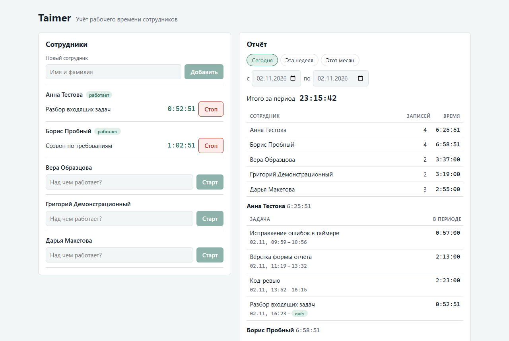
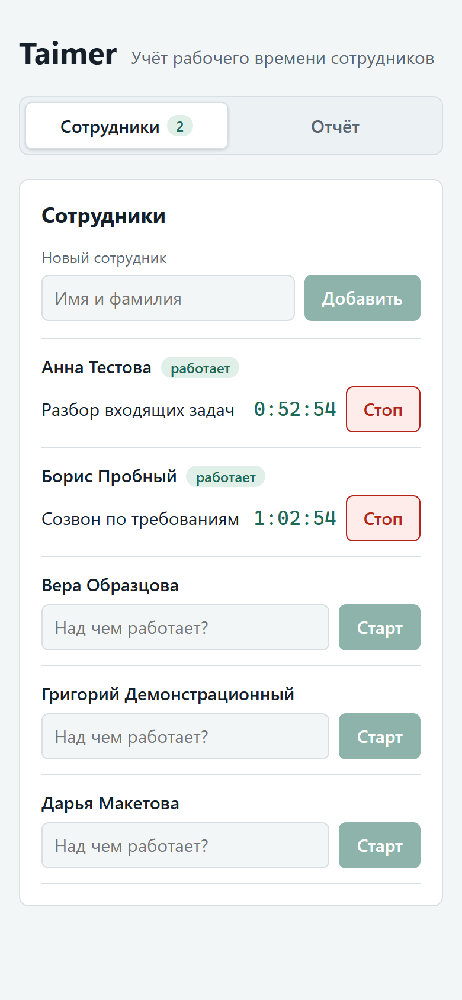
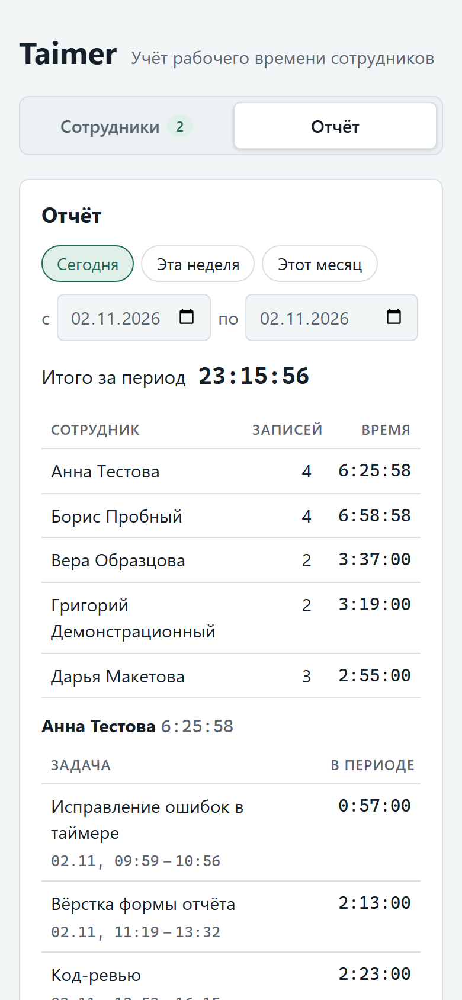

# Taimer

Учёт рабочего времени сотрудников. Можно добавить сотрудника, запустить и остановить таймер с описанием задачи и посмотреть записи и общее время каждого сотрудника за выбранный период. Данные хранятся в файле SQLite и переживают перезапуск. Авторизации нет. Все данные в проекте и тестах вымышленные.



<p>
  
  &nbsp;
  
</p>

Скриншоты сняты на демо-данных `npm run seed`. На компьютере сотрудники и отчёт стоят рядом, на телефоне разнесены по вкладкам.

## Запуск

Нужен Node.js 22 (от 22.13), 24 или 26 и новее; проверено на 22.17.1, 24.22.2 и 26.13.0. На другой версии `npm install` сразу останавливается с ошибкой `EBADENGINE`, в которой указаны нужная и текущая версии (`engine-strict` в `.npmrc`). Без этой настройки установка прошла бы с предупреждением, а сервер упал бы при запуске: до 22.13 в Node нет `node:sqlite` без флага. Node 23 и 25 исключены, потому что их не поддерживают Vitest и jsdom.

Docker и внешние сервисы не нужны: база встроена в Node (`node:sqlite`), нативных модулей нет.

```bash
npm install
npm run seed   # необязательно: 5 вымышленных сотрудников и записи за две недели
npm start      # сборка и запуск: http://localhost:3000
```

База создаётся при первом запуске в `data/taimer.db`. Путь и порт меняются переменными окружения `DB_PATH` и `PORT`. `npm run seed` пишет только в пустую базу: на базе с сотрудниками он ничего не меняет и завершается с ошибкой.

| Команда | Что делает |
|---|---|
| `npm start` | собирает сервер и клиент, запускает на `:3000` |
| `npm run dev` | режим разработки: API с перезапуском на `:3000`, Vite с горячей перезагрузкой на `:5173` (открывать его) |
| `npm test` | все тесты (Vitest): API и интерфейс, около 6 секунд |
| `npm run typecheck` | проверка типов сервера, клиента и тестов |
| `npm run seed` | демо-данные в пустую базу |
| `npm run serve` | запуск уже собранного `dist` без повторной сборки |

## Что умеет

- **Сотрудники.** Имя от 1 до 100 символов; пробелы по краям убираются, повторные внутри схлопываются. Если имя совпадает с уже добавленным (без учёта регистра и «ё/е»), форма предупреждает. Тёзки бывают, поэтому добавить второго можно.
- **Таймер.** Старт с описанием задачи от 1 до 200 символов, стоп, живой счётчик. У сотрудника не больше одного идущего таймера, это гарантирует база (см. ниже). Повторный старт даёт понятную ошибку. Таймер дольше 12 часов подсвечивается: возможно, его забыли остановить.
- **Отчёт.** Сегодня, эта неделя (пн–вс), этот месяц или свои даты. Итог за период, таблица по всем сотрудникам (кто не работал, показан с нулём), записи каждого с началом и концом. Идущие таймеры досчитываются на лету. Есть пустые состояния: нет сотрудников, нет записей за период. «Сегодня» само переходит на новый день, если страница открыта через полночь.
- **Интерфейс.** На телефоне сотрудники и отчёт разнесены по вкладкам. Есть тёмная тема, всё доступно с клавиатуры. Если сервер не отвечает, появляется баннер с кнопкой «Повторить».

## Стек и почему

Критерии выбора: проверяющий запускает проект одной командой без Docker, код короткий и читаемый, основные сценарии покрыты быстрыми тестами.

| Часть | Выбор | Почему |
|---|---|---|
| Язык | TypeScript (strict) | Один язык на сервере и в браузере, общие типы API в `src/shared`. Строгий режим ловит часть ошибок генерации: забытый `null`, перепутанные поля |
| Сервер | Node.js 22 + Fastify 5 | Валидация тела по JSON Schema встроена. `app.inject()` гоняет HTTP-запросы в тестах без порта |
| База | SQLite через `node:sqlite` | Один файл, транзакции, SQL для выборок по периоду. Встроен в Node, поэтому ничего не компилируется у проверяющего |
| Клиент | React 19 + Vite | Живой счётчик и формы проще описать декларативно. Собранную статику раздаёт тот же Fastify: один процесс, один порт |
| Тесты | Vitest | TypeScript и ESM без настройки. Часы передаются в приложение параметром, поэтому тесты не зависят от реального времени |

Рассматривали и не взяли: Express (валидацию и тестовый клиент пришлось бы подключать отдельно), Next.js (избыточен для двух блоков и пяти маршрутов), PostgreSQL в Docker (лишний шаг у проверяющего), JSON-файл (нет транзакций), better-sqlite3 (нативный модуль, без готовой сборки нужен компилятор).

**Компромиссы.**
- `node:sqlite` в Node 22 помечен как экспериментальный. Предупреждение при старте заглушено флагом `--disable-warning=ExperimentalWarning`. Вся работа с базой собрана в `src/server/db.ts`, так что замена драйвера затронет один файл.
- В `package.json` есть `overrides` для `glob`: `@fastify/static` зависит от `glob@13` с известными уязвимостями (`npm audit`, средняя тяжесть), а `npm audit fix` откатил бы плагин на версию, несовместимую с Fastify 5. Подставлен исправленный `glob@14.0.3`, раздачу статики с ним проверяет `tests/static.test.ts`. `npm audit`: 0 уязвимостей.
- В `package.json` есть `allowScripts` для esbuild. npm 11.19 и новее (идёт с Node 24 и 26) не запускает скрипты установки пакетов без разрешения и предупреждает о них. Единственный такой скрипт в зависимостях, `postinstall` у esbuild, разрешён. Так установка ведёт себя одинаково на старом и новом npm.

## Устройство

```
src/
  shared/      общий код сервера и клиента
    types.ts     типы запросов и ответов, лимиты, коды ошибок
    time.ts      формат длительности, границы периода в поясе браузера, пресеты, досчёт идущих таймеров
    names.ts     сравнение имён для предупреждения о тёзке
  server/
    app.ts       buildApp({ db, now, webDir }): приложение без привязки к порту
    routes.ts    маршруты и JSON Schema; логики в них нет
    employees.ts, timer.ts, report.ts   сервисы с SQL
    period.ts    строгий разбор дат и доля записи в периоде (чистые функции)
    db.ts        открытие базы и миграции через PRAGMA user_version
    errors.ts    единый формат ошибок { error, message }
    demo-data.ts, seed.ts   npm run seed
    config.ts    путь к файлу базы
    index.ts     запуск: порт, файл базы, корректное завершение
  web/
    App.tsx      раскладка, вкладки на узком экране
    api.ts       типизированный клиент API
    components/  EmployeeForm, EmployeeRow, PeriodPicker, ReportView, Tabs
    serverClock.ts  поправка на разницу часов браузера и сервера
    hooks/       useNow, useToday, useMediaQuery
tests/          Vitest: API на базе в памяти, перезапуск на временном файле
  web/          интерфейс в jsdom поверх настоящего API
docs/
  plan.md       план: требования, правила предметной области, спринты и критерии готовности
  ai-log.md     журнал работы с ИИ по спринтам
  screenshots/
```

### API

| Метод и путь | Ответ | Ошибки |
|---|---|---|
| `GET /api/employees` | сотрудники в порядке добавления, у каждого `activeEntry` или `null` | |
| `POST /api/employees` `{ name }` | 201, сотрудник | 400 |
| `POST /api/employees/:id/timer/start` `{ task }` | 201, запись | 400, 404, 409 `TIMER_ALREADY_RUNNING` |
| `POST /api/employees/:id/timer/stop` | 200, закрытая запись | 404, 409 `TIMER_NOT_RUNNING` |
| `GET /api/report?from=…&to=…` | все сотрудники с записями и итогами, общий итог | 400 |
| `GET /api/health` | `{ status: "ok" }` | |

Ошибки всегда приходят в виде `{ error: "КОД", message: "текст для человека" }`.

### Правила учёта времени

- **Один идущий таймер на сотрудника** закреплён частичным уникальным индексом `ON time_entries(employee_id) WHERE ended_at IS NULL`. Перед вставкой нет проверки «идёт ли таймер»: между проверкой и вставкой мог бы проскочить второй запрос. Нарушение индекса превращается в 409. Два одновременных старта дают одну запись, это проверено тестом.
- **Время хранится в UTC, целыми секундами.** Если хранить миллисекунды, а показывать секунды, итог отчёта расходится с суммой строк (см. ошибки ниже).
- **Период — полуинтервал `[from, to)`** в ISO 8601 с обязательным часовым поясом: `2026-11-02T00:00:00+03:00`. Дата без пояса, несуществующая дата вроде 30 февраля и незакодированный `+` в query дают 400 с объяснением.
- **Границы суток считает браузер** в своём поясе по календарным дням, поэтому в дни перевода часов сутки длятся 23 или 25 часов. Сервер работает с моментами времени и от пояса машины не зависит.
- **Запись на границе периода** отдаётся целиком, а в итог идёт только её часть внутри периода. Идущий таймер считается до момента запроса.

## Тесты

`npm test`: 14 файлов, 179 тестов, около 6 секунд. Тесты разделены на два проекта Vitest:
- **`api`**: запросы через `app.inject()` на базе в памяти, с управляемыми часами `TestClock`;
- **`web`**: приложение рендерится в jsdom (React Testing Library), а `fetch` направлен в `app.inject()` настоящего сервера с базой в памяти. Ответы API здесь не подменяются: тест проходит и клиентский, и серверный код, заменена только сеть.

| Сценарий | Где |
|---|---|
| Повторный старт: 409, текущая запись не меняется; два одновременных старта; старт после стопа; повторный стоп. В интерфейсе: таймер запустили в другой вкладке, строка показывает ошибку и идущий таймер | `tests/timer.test.ts`, «повторный запуск»; `tests/web/app.test.tsx` |
| Пустой отчёт: нет сотрудников; сотрудники есть, а записей за период нет. В интерфейсе оба пустых состояния | `tests/report.test.ts`, «пустой отчёт»; `tests/web/app.test.tsx` |
| Интерфейс: полный цикл с клавиатуры (добавить, старт, стоп, запись в отчёте), предупреждение о тёзке, вкладки на узком экране | `tests/web/app.test.tsx` |
| Данные после перезапуска: сотрудники, записи, идущий таймер считает время простоя, запрет второго таймера действует | `tests/persistence.test.ts`, `tests/db.test.ts` |
| Обрезка записей по границам, идущий таймер, часовые пояса, итог равен сумме строк | `tests/report.test.ts` |
| Строгий разбор дат, календарь, високосные годы, доля записи в периоде | `tests/period.test.ts` |
| Валидация: пустые и длинные поля, типы не приводятся, кодировка тела, `__proto__` | `tests/employees.test.ts`, `tests/timer.test.ts`, `tests/request-body.test.ts` |
| Клиентская логика времени: формат, границы периода в дни перевода часов, пресеты, переход через полночь, год в датах, долгий таймер | `tests/time.test.ts` (в поясе Europe/Berlin) |
| Тёзки, демо-данные, раздача собранного клиента, путь к базе | `tests/names.test.ts`, `tests/demo-data.test.ts`, `tests/static.test.ts`, `tests/config.test.ts` |

**Тесты проверены поломкой кода:** в код по одной вносились правдоподобные ошибки, и каждая должна была уронить хотя бы один тест. В сервере это, например, неуникальный индекс, включительные границы периода, неучтённый идущий таймер. В интерфейсе: строка не перечитывает список после ответа, ошибка 409 не показывается, стрелка не переключает вкладку. Интерфейс дополнительно проверен в Chrome по чек-листу: сценарии задания, узкий экран, тёмная тема, работа с клавиатуры, остановка и перезапуск сервера.

## ИИ-инструменты

| Инструмент | Модель | Для чего |
|---|---|---|
| Claude Code (агент в терминале) | Claude Opus 5.5 (`claude-opus-5-5`) | план и выбор стека, код, тесты, документация |
| Claude in Chrome | та же | проверка интерфейса в браузере: узкий экран, тёмная тема, клавиатура |
| `/code-review` в Claude Code | та же | итоговое ревью всего кода |

Работа шла спринтами по плану: каркас, сотрудники и таймер, отчёт, интерфейс, стабилизация, подготовка к сдаче. План с требованиями, правилами предметной области и критериями готовности: [`docs/plan.md`](docs/plan.md). В каждом спринте модель писала код вместе с тестами, затем результат проверялся тестами, проверкой типов, запросами к собранному серверу и вручную в браузере. Журнал решений и проверок по спринтам: [`docs/ai-log.md`](docs/ai-log.md).

### Примеры промптов

Модели передавалось задание из плана: цель, правила, проверки и критерий готовности. Ниже такие задания в сокращённом виде.

**Спринт API.** Правила предметной области и проверки заданы до кода, поэтому тесты пишутся по требованиям, а не по готовой реализации.

```text
Спринт S1: сотрудники и таймер. Цель: API для добавления сотрудников, старта и стопа
таймера, ошибки в формате { error, message }.
Правила: у сотрудника не больше одного идущего таймера, и это гарантирует база,
а не проверка перед вставкой. Задача обязательна, от 1 до 200 символов.
Сначала тесты: повторный старт даёт 409 и не создаёт запись; старт после стопа создаёт
новую; стоп без таймера даёт 409; несуществующий сотрудник даёт 404; два сотрудника
работают одновременно. Готово, когда все сценарии покрыты и проходят.
```

**Ревью.** Находки не принимаются на веру: каждую сначала воспроизводят.

```text
/code-review high по всему коду. Каждую находку сначала воспроизведи тестом, скриптом
или в браузере, исправляй только подтверждённые. Новый тест должен падать без исправления.
Если находку не исправляем, запиши её в ограничения README с причиной.
```

**Проверка в браузере.** Отдельная база с данными на граничные случаи.

```text
Проверь интерфейс в Chrome на отдельной базе с вымышленными граничными данными:
имя из 70 букв без пробелов, записи через полночь, таймер, идущий третьи сутки.
Ширина 390 px, тёмная тема, только клавиатура, сервер остановлен и запущен снова.
Для каждой проблемы: шаги, ожидаемое поведение, фактическое.
```

**Тесты интерфейса.**

```text
Тесты интерфейса на React Testing Library поверх настоящего API: fetch направь
в app.inject() с базой в памяти, ответы не подменяй. Сценарии: полный цикл,
повторный старт, когда таймер запустили в другой вкладке, оба пустых отчёта, тёзка,
вкладки с клавиатуры. Проверь поломками компонентов: каждая должна ронять тест.
```

### Найденные и исправленные ошибки

В колонке «Проверка» указан тест, который падает, если ошибку вернуть. «Браузер» значит, что ошибка зависит от вёрстки или порядка сетевых ответов и проверена в Chrome.

| Ошибка | Исправление | Проверка |
|---|---|---|
| Fastify приводил типы: `{ "name": true }` создавал сотрудника «true», `{ "task": 42 }` задачу «42» | приведение типов отключено, `id` в пути проверяется шаблоном | `employees.test.ts`, `timer.test.ts` |
| `Date.parse` принимал неверные периоды: 30 февраля становилось 2 марта, дата без пояса читалась в поясе сервера, `+` в query превращался в пробел | строгий ISO 8601 с обязательным поясом и проверкой календаря | `period.test.ts` |
| Проверка календаря через `Date.UTC` ошибалась на годах 0–99 | явный расчёт дней в месяце | `period.test.ts` |
| Итог отчёта на секунду больше суммы строк (миллисекунды строк округлялись по отдельности) | время в целых секундах: при хранении, расчёте доли в периоде и досчёте на экране | `report.test.ts`, `timer.test.ts`, `time.test.ts` |
| Тело не в UTF-8 сохранялось как «����» | тело читается строго как UTF-8, иначе 400 | `request-body.test.ts` |
| Разница часов браузера и сервера попадала в таймеры: при часах, спешащих на 3 минуты, новый таймер показывал 0:03:00 | время на экране считается по часам сервера из ответов API | `time.test.ts`, браузер |
| Запись, начатая после расчёта отчёта (часы сервера ушли назад), досчитывалась с лишним временем | досчёт от начала записи | `time.test.ts` |
| «Сегодня» не переходило на новый день, если страница открыта через полночь | хранится пресет, а не даты; день пересчитывается в полночь и при возвращении на вкладку | `time.test.ts` |
| Пока база занята вторым соединением (например, `npm run seed`), запросы сразу падали с 500 | `busy_timeout` 5 секунд | `db.test.ts` |
| Пустой `DB_PATH` открывал временную базу, данные терялись при перезапуске | пустое значение означает путь по умолчанию | `config.test.ts` |
| Ответы на перечитывание списка сотрудников могли прийти не по порядку и вернуть форму «Старт» у запущенного таймера | запросы списка идут по очереди | браузер |
| После ошибки загрузки отчёт за прежний период оставался под новыми датами; «обновляем…» могло зависнуть | отчёт привязан к своему периоду: при загрузке приглушён, после ошибки скрыт | браузер |
| На телефоне таблицы и длинные слова давали горизонтальную прокрутку, дата и время записи разрывались | фиксированная раскладка таблиц, управляемые переносы | браузер |
| Фокус клавиатуры терялся после «Добавить», «Старт», «Стоп»; ошибка под строкой оставалась после изменений в другой вкладке | фокус возвращается к следующему действию, ошибка привязана к записи | `tests/web/app.test.tsx` (старт и стоп), браузер |

## Ограничения и что дальше

- **Записи нельзя редактировать и удалять, сотрудников тоже.** Забытый таймер можно только остановить, и он посчитает лишнее время. Следующий шаг: правка времени окончания записи. Это новый маршрут в `routes.ts`, функция в `timer.ts` с той же проверкой `ended_at >= started_at` и кнопка в отчёте.
- **Отчёт отдаёт все записи периода одним ответом.** Для месяца на небольшую команду этого хватает, для года понадобится постраничная выдача.
- **Отчёт отбирает записи по индексу `started_at < to`, то есть просматривает всю историю до конца периода.** Одного индекса по `ended_at` недостаточно: `EXPLAIN QUERY PLAN` показывает, что SQLite его не выбирает. Нужен запрос из двух веток: закрытые записи по `ended_at >= from` и идущие. Это стоит делать, когда записей станут десятки тысяч.
- **Интерфейс перерисовывается целиком раз в секунду, пока идёт хоть один таймер.** Для десятков сотрудников это незаметно. Для сотен стоит мемоизировать строки и передавать `now` только идущим.
- **Старт таймера делает отдельный запрос «есть ли сотрудник»,** хотя внешний ключ поймал бы и это. Отдельная проверка оставлена ради порядка ошибок: сначала содержимое запроса, потом существование сотрудника.
- **Один процесс и один файл SQLite.** Для нескольких серверов базу нужно менять. Логика собрана в сервисах, и SQL там простой.
- **Тесты интерфейса покрывают сценарии задания, но не всё.** Порядок сетевых ответов, приглушение устаревшего отчёта, вёрстка на узком экране и фокус после «Добавить» проверены в браузере. jsdom не считает раскладку и, в отличие от браузера, не снимает фокус с заблокированного поля. Следующий шаг: Playwright на собранном приложении.
- **Схема меняется только добавлением миграции** в конец списка в `db.ts`, старые миграции не редактируются.
